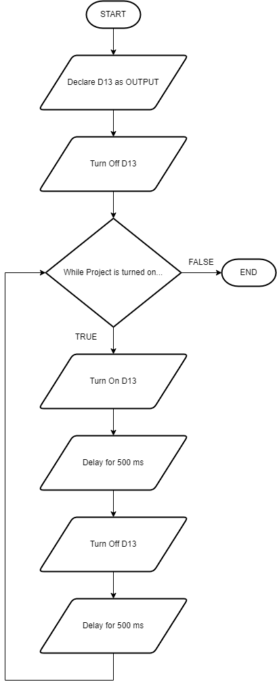
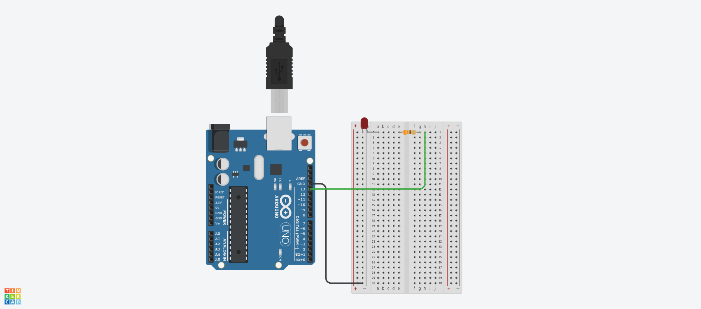
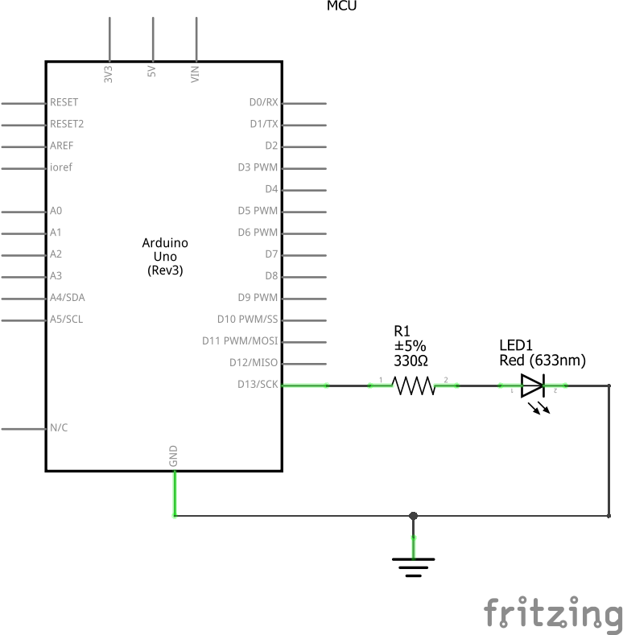

# Project 1: Blink an LED
This project contains Arduino source codes for blinking an LED.

## Version History
| No. | Date Created/Modified | Author | Remarks|
|---|---|---|---|
| 0.0 | January 18, 2025 | Engr. Bien Carlo Halili | Created branch for Project 1 and added files to conform to the Project Structure. |

## Flowchart

## Bill of Materials
Refer to the table below for the components used in this project.
| Component Name | Quantity |
|---|---|
| Arduino UNO R3 | 1 | 
| Red LED (Light-Emitting Diode) | 1 |
| 330 Ohms Resistor | 1 | 
| Small Breadboard | 1 | 
| MM Jumper Wires | 2 | 

## Circuit View

## Schematic View

## Lecture Notes
### Embedded Systems Programming
It is a development process for microcontrollers/microcomputers.
### Resistors
It is an electrical components that limits current passing through the circuit. Also known as Current Limiter.
### LEDs
Known as Light-Emitting Diode. This component produces light when a current pass through it.
### Breadboard
It is where engineers/hobbyists place the components to form a project to be tested/developed.
### Code Glossary
| Code Implementation | Purpose |
|---|---|
| pinMode() | Declare an arduino pin as an INPUT or OUTPUT. | 
| digitalWrite() | Send a signal to the arduino either HIGH or LOW. | 
| setup() | Codes defined in this function will only run once. | 
| loop() | Codes defined in this function will run continuously. | 