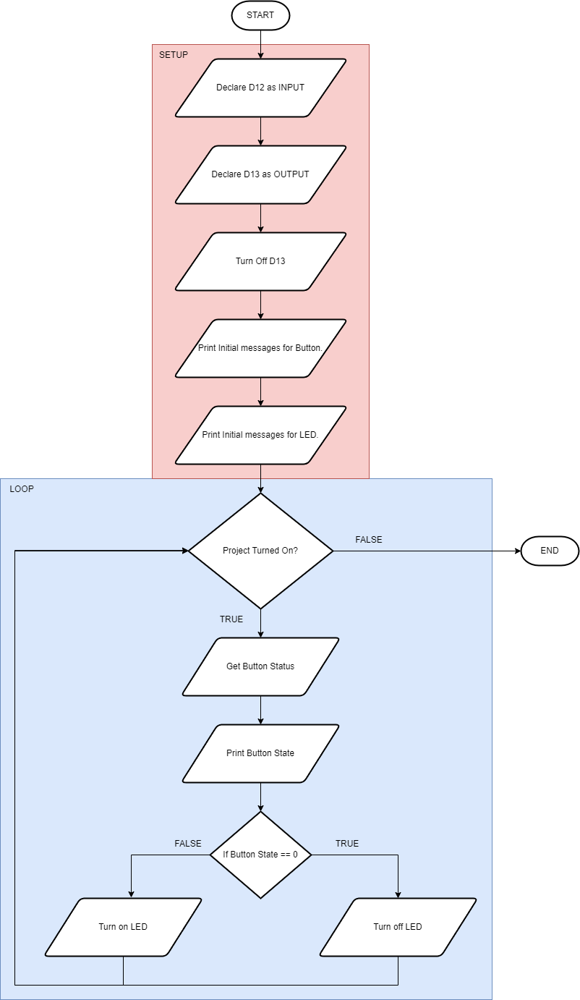
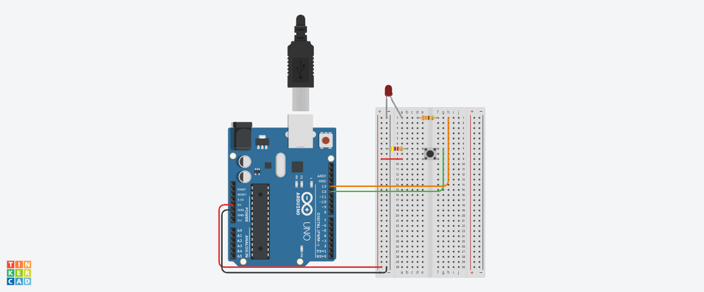
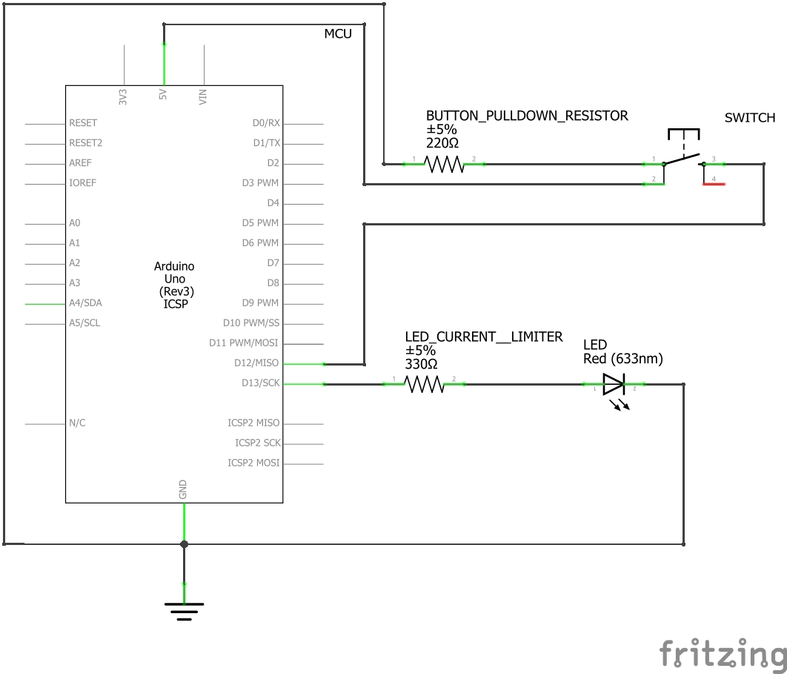

# Project 2: LED Switch
This project contains Arduino source codes for turn on and off of an LED using a push button switch.

## Version History
| No. | Date Created/Modified | Author | Remarks|
|---|---|---|---|
| 0.0 | January 25, 2025 | Engr. Bien Carlo Halili | Created branch for Project 2 and added files to conform to the Project Structure. |

## Flowchart

## Bill of Materials
Refer to the table below for the components used in this project.
| Component Name | Quantity |
|---|---|
| Arduino UNO R3 | 1 | 
| Red LED (Light-Emitting Diode) | 1 |
| 330 Ohms Resistor | 1 | 
| 4.7 Kilo-Ohms Resistor | 1 | 
| Small Breadboard | 1 | 
| MM Jumper Wires | 5 | 
| Push Button Switch (4-pin) | 1 | 

## Circuit View

## Schematic View

## Lecture Notes
### Pull Resistors
It has two types: pull-up and pull-down. Pull-up resistors configures the digital signal passing through the specific digital input pin as HIGH when a switch is not pressed. Pull-down resistors configures the digital signal passing through the specific digital input pin as LOW when a switch is not pressed.
### Switches
It is used as a current passer or blocker. Fundamentally used in switching scenarios such as lighting.
### Code Glossary
| Code Implementation | Purpose |
|---|---|
| Serial.begin() | This is used for setting up a Serial monitor that gives outputs that can be used for troubleshooting purposes. | 
| Serial.println() | Displays an output in the serial monitor. | 
| digitalRead() | This is used to get the current signal passing through a specific digital input pin. | 
| Conditional Statements | Coding fundamental that is used for executing an outcome based on the condition. Another outcome can be executed if there's an alternative condition. |