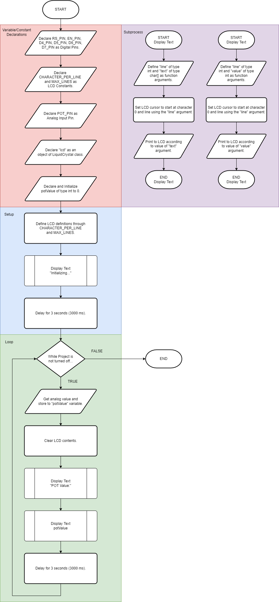
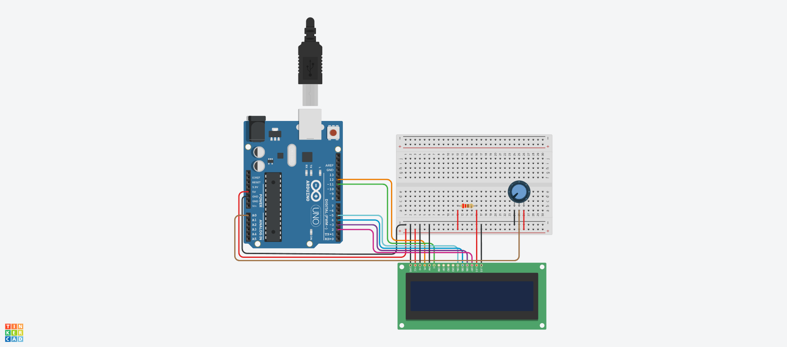
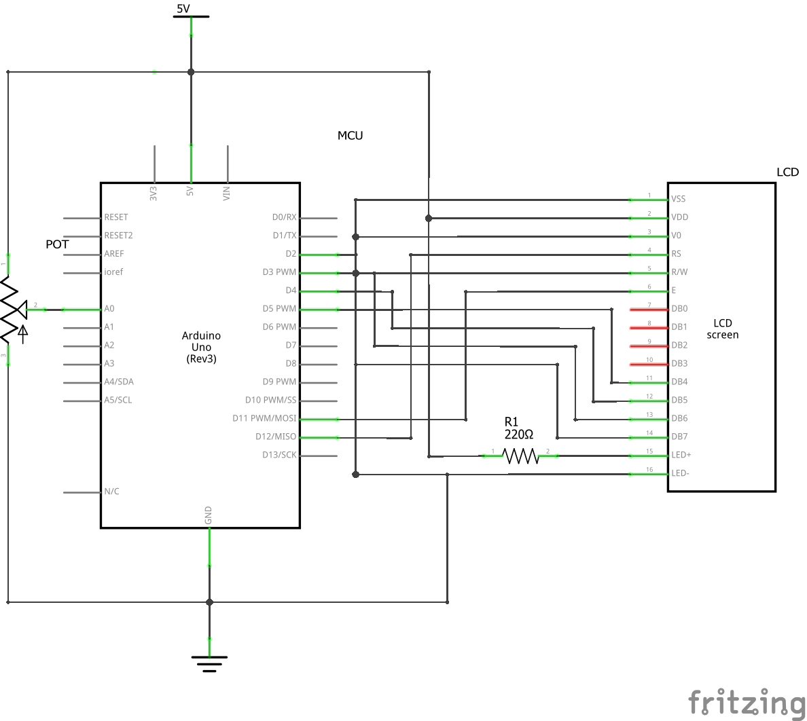

# Project 3: Potentiometer-LCD Interfacing
This project demonstrates a potentiometer for analog input then an LCD for output.

## Version History
| No. | Date Created/Modified | Author | Remarks|
|---|---|---|---|
| 0.0 | February 8, 2025 | Engr. Bien Carlo Halili | Created branch for Project 3 and added files to conform to the Project Structure. |

## Flowchart

## Bill of Materials
Refer to the table below for the components used in this project.
| Component Name | Quantity |
|---|---|
| Arduino UNO R3 | 1 | 
| 10K Potentiometer | 1 |
| 220 Ohms Resistor | 1 | 
| Small Breadboard | 1 | 
| 16x2 Liquid Crystal Display | 1 |
| MF Jumper Wires | 6 | 
| MM Jumper Wires | 10 |  

## Circuit View

## Schematic View

## Lecture Notes
### Potentiomeneter
It is a electronic component that can yield different values according to tuning. One of the useful components in learning Analog Input in microcontrollers.
### LCD
Stands for Liquid Crystal Display. It is used for displaying information based on the embedded engineer's desired outcome.
### Code Glossary
| Code Implementation | Purpose |
|---|---|
| lcd.begin() | This is used for setting up an LCD viewing dimensions that gives outputs that can be used for troubleshooting purposes. | 
| lcd.print() | Displays an output in an LCD. | 
| lcd.clear() | This is used to clear all contents in the LCD. | 