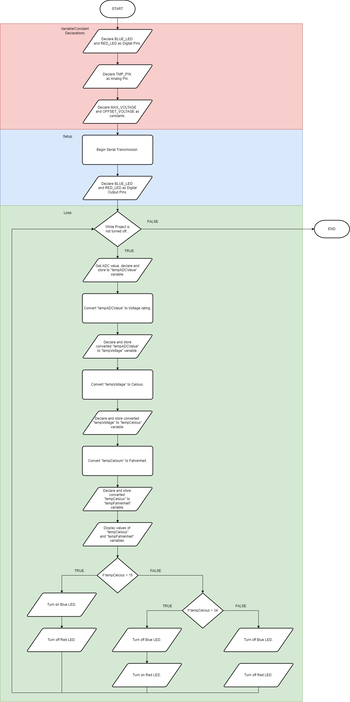
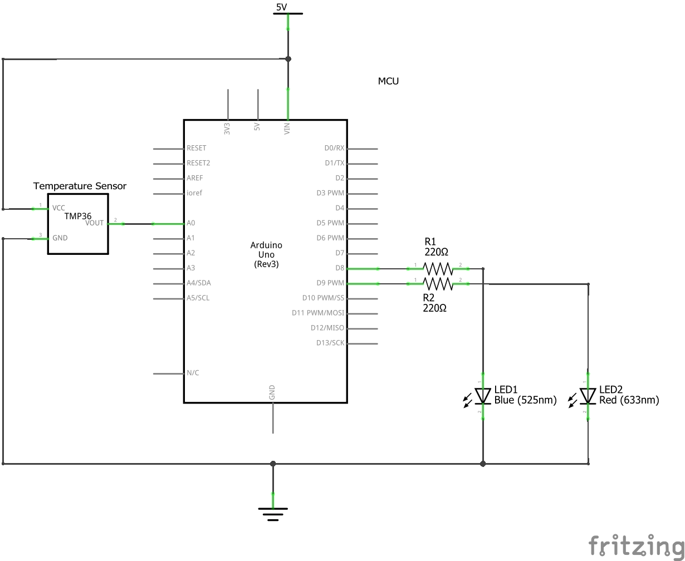

# Project 4: Temperature Sensing
This project demonstrates Temperature Sensing for LED indication for output.

## Version History
| No. | Date Created/Modified | Author | Remarks|
|---|---|---|---|
| 0.0 | February 15, 2025 | Engr. Bien Carlo Halili | Created branch for Project 4 and added files to conform to the Project Structure. |

## Flowchart

## Bill of Materials
Refer to the table below for the components used in this project.
| Component Name | Quantity |
|---|---|
| Arduino UNO R3 | 1 | 
| TMP36 Temperature Sensor | 1 |
| 220 Ohms Resistor | 2 | 
| Small Breadboard | 1 | 
| 2 LEDs (1 blue; 1 red) | 2 |
| MM Jumper Wires | 9 |  

## Circuit View

## Schematic View

## Lecture Notes
### Temperature Sensor
It is a electronic component that can measure analog signals in temperature then can be converted such signals to Celsius and Fahrenheit.