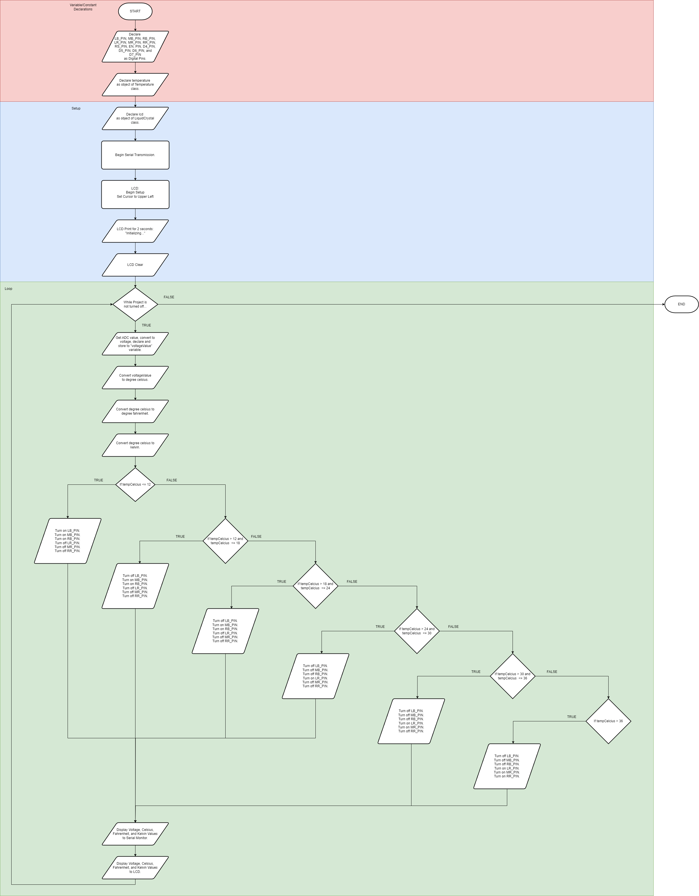
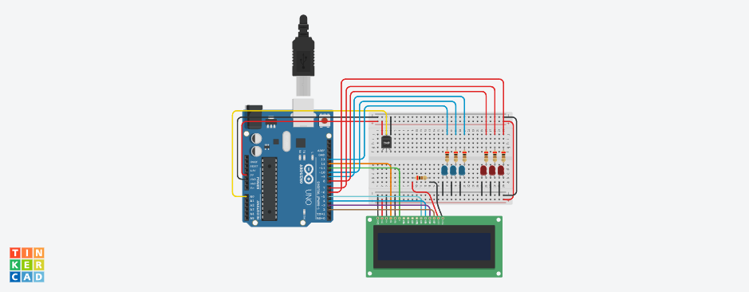
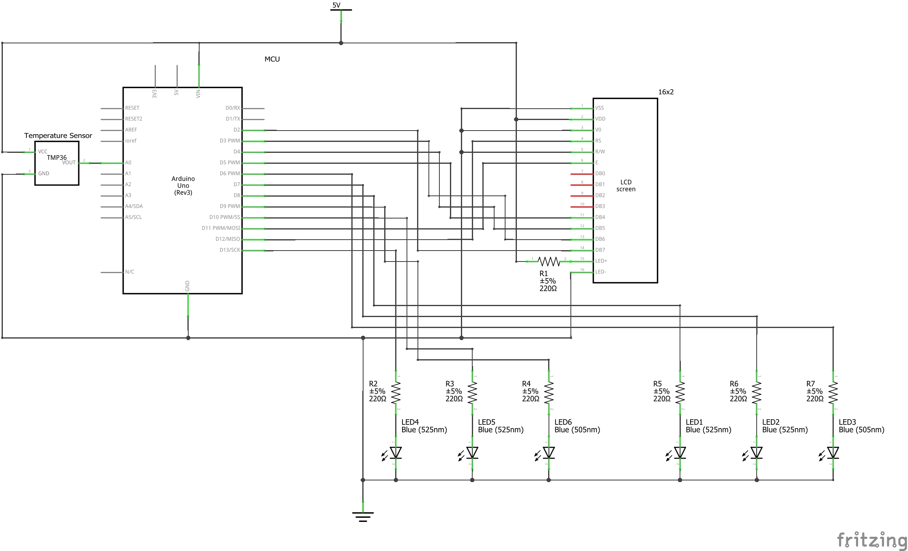

# Project 5: Temperature Station
This project demonstrates Temperature Station for LED indication LCD Display for output.

## Version History
| No. | Date Created/Modified | Author | Remarks|
|---|---|---|---|
| 0.0 | February 22, 2025 | Engr. Bien Carlo Halili | Created branch for Project 5 and added files to conform to the Project Structure. |

## Flowchart

## Bill of Materials
Refer to the table below for the components used in this project.
| Component Name | Quantity |
|---|---|
| Arduino UNO R3 | 1 | 
| TMP36 Temperature Sensor | 1 |
| 220 Ohms Resistor | 7 | 
| Small Breadboard | 1 | 
| 6 LEDs (3 blue; 3 red) | 6 |
| MM Jumper Wires | 27 |  

## Circuit View

## Schematic View
